


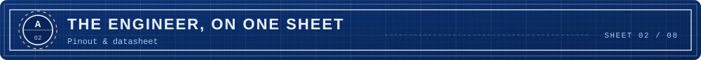


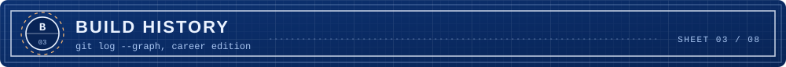


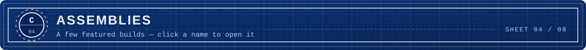

<a href="https://github.com/BhonePyaeMin/AI-Powered-Network-Configuration-Automation">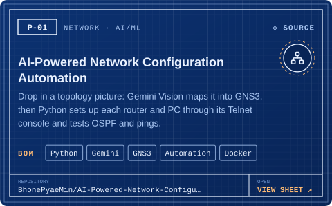</a>
<a href="https://github.com/BhonePyaeMin/Study_Ai">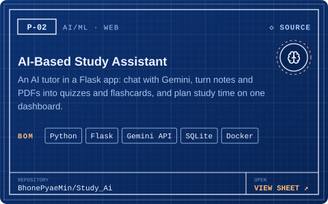</a>
<a href="https://github.com/BhonePyaeMin/netlab-3d">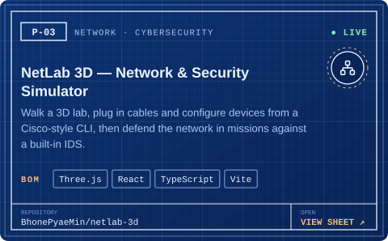</a>
<a href="https://github.com/BhonePyaeMin/asset_borrowing_system">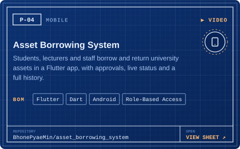</a>
<a href="https://github.com/BhonePyaeMin/network-port-scanner">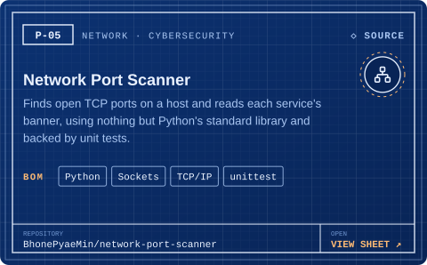</a>
<a href="https://github.com/BhonePyaeMin/GNS3-Live-Topology-Resilience-Dashboard">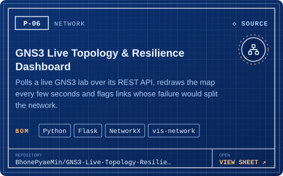</a>
<a href="https://github.com/BhonePyaeMin/Restaurant-Ordering-System">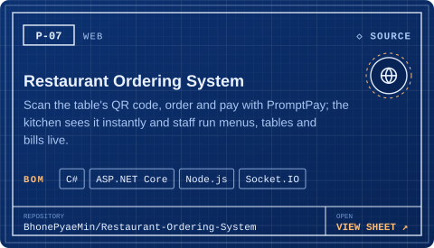</a>
<a href="https://github.com/BhonePyaeMin/Mail-Shield">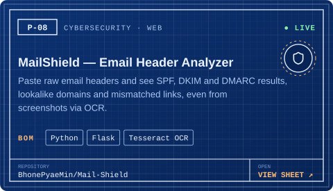</a>
<a href="https://github.com/BhonePyaeMin/Spider-Lily">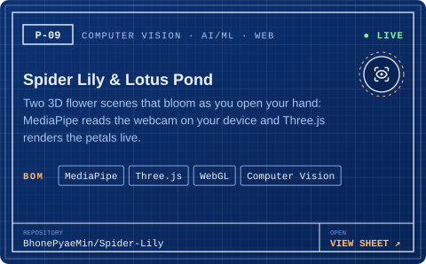</a>
<a href="https://github.com/BhonePyaeMin/Letter">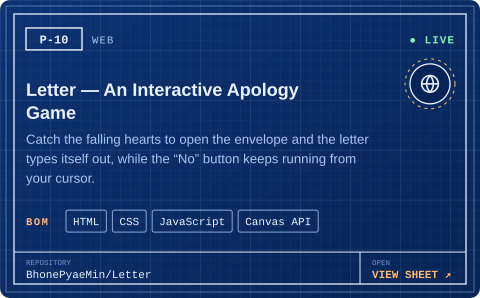</a>
<a href="https://github.com/BhonePyaeMin/secure-expense-tracker">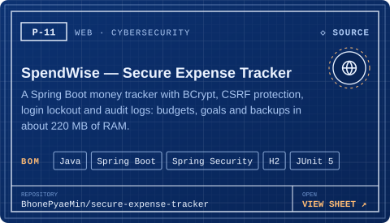</a>
<a href="https://bhonepyaemin.com/#projects">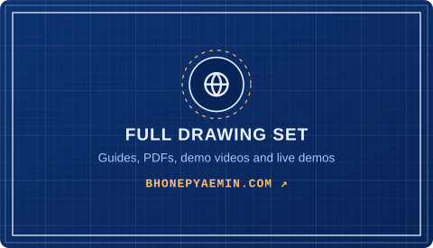</a>

<b>Running live:</b> <a href="https://bhonepyaemin.com/netlab/">NetLab 3D</a> · <a href="https://bhonepyaemin.com/mailshield/">MailShield</a> · <a href="https://bhonepyaemin.com/spiderlily/">Spider Lily</a> · <a href="https://bhonepyaemin.com/lotus/">Lotus Pond</a> · <a href="https://bhonepyaemin.com/letter/">Letter</a> &nbsp;·&nbsp; <b>Guides & PDFs:</b> <a href="https://bhonepyaemin.com/#projects">bhonepyaemin.com</a>

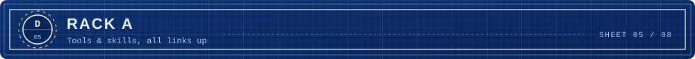


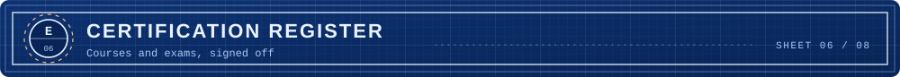


<b>Verify a certificate</b>

| Certificate | Issuer | Link |
|---|---|---|
| Google AI Essentials | Google AI Essentials — Coursera | [Verify ↗](https://coursera.org/verify/specialization/5SS4TV6B54PW) |
| Introduction to AI | Google AI Essentials — Coursera | [Verify ↗](https://coursera.org/verify/TEBIXW6U2HO4) |
| Maximize Productivity With AI Tools | Google AI Essentials — Coursera | [Verify ↗](https://coursera.org/verify/TQ7LD7UXZ9SX) |
| Discover the Art of Prompting | Google AI Essentials — Coursera | [Verify ↗](https://coursera.org/verify/UUEXTHN1UB3X) |
| Use AI Responsibly | Google AI Essentials — Coursera | [Verify ↗](https://coursera.org/verify/A196VU5ODVEB) |
| Stay Ahead of the AI Curve | Google AI Essentials — Coursera | [Verify ↗](https://coursera.org/verify/2YKK24R8XPE1) |
| Foundations of Cybersecurity | Google Cybersecurity — Coursera | [Verify ↗](https://coursera.org/verify/Q0ZK1W6WHBTO) |
| Play It Safe: Manage Security Risks | Google Cybersecurity — Coursera | [Verify ↗](https://coursera.org/verify/YZUNHIOAMKMK) |
| Connect and Protect: Networks and Network Security | Google Cybersecurity — Coursera | [Verify ↗](https://coursera.org/verify/9NXCOC1AUQ9E) |
| HCIA Datacom | Huawei | [Verify ↗](https://e.huawei.com/cn/talent/#/cert/certificate-verification) |
| HCCDA Tech Essentials | Huawei | Listed on my portfolio |
| Claude 101 | Anthropic | Listed on my portfolio |
| Claude Code 101 | Anthropic | Listed on my portfolio |
| Claude Platform 101 | Anthropic | Listed on my portfolio |
| Intro to Claude Cowork | Anthropic | Listed on my portfolio |

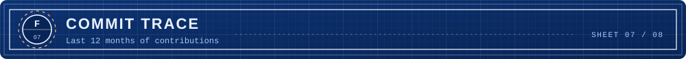

<picture>
  <source media="(prefers-color-scheme: dark)" srcset="https://raw.githubusercontent.com/BhonePyaeMin/BhonePyaeMin/output/github-snake-dark.svg" />
  <source media="(prefers-color-scheme: light)" srcset="https://raw.githubusercontent.com/BhonePyaeMin/BhonePyaeMin/output/github-snake.svg" />
  
</picture>

Redrawn every day from the last 12 months of commits.

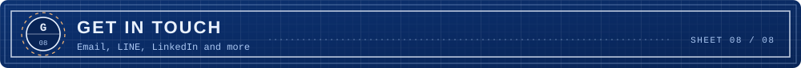

Have an internship, a network to automate or a build in mind? Send it over.

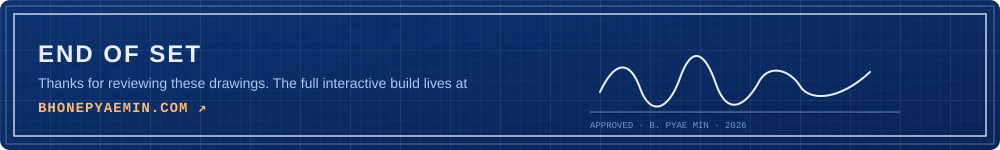

