


## 👋 About me

<code>// about me</code>

### Building systems, exploring networks, and turning ideas into practical solutions.

I'm a computer engineering student focused on networking, cybersecurity, and the automation that ties them together. My work spans network simulation, AI-assisted configuration, and full-stack development — connecting infrastructure fundamentals with the software that runs on top of them.

I approach every project by taking it apart first — a router, a topology, a script that isn't working — then rebuilding it until I understand every layer underneath. Whether it's a Cisco CLI session, a GNS3 topology, or an AI tool that automates the boring parts, I care about knowing why it works, not just that it does.

`Network Engineering` · `Cybersecurity` · `AI / ML` · `Automation`

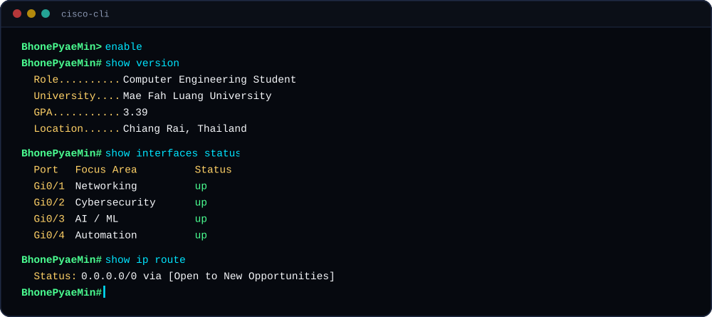

## 🧭 Career path

<code>// career</code>

### Growing through engineering and experience.

An evolving journey through education, technical projects, hands-on learning, and professional development.


## 🚀 Projects

<code>// selected work</code>

### Turning technical ideas into working systems.

A collection of projects exploring networking, automation, cybersecurity, software development, and AI/ML.

<table>
<tr>
<td width="50%" valign="top">
<a href="https://github.com/BhonePyaeMin/AI-Powered-Network-Configuration-Automation"></a>

<a href="https://github.com/BhonePyaeMin/AI-Powered-Network-Configuration-Automation">Source</a> · <a href="https://bhonepyaemin.com/docs/ai-network-config.pdf">PDF</a>

</td>
<td width="50%" valign="top">
<a href="https://github.com/BhonePyaeMin/Study_Ai"></a>

<a href="https://github.com/BhonePyaeMin/Study_Ai">Source</a> · <a href="https://bhonepyaemin.com/docs/study-assistant-guide.pdf">PDF</a>

</td>
</tr>
<tr>
<td width="50%" valign="top">
<a href="https://github.com/BhonePyaeMin/netlab-3d"></a>

<a href="https://github.com/BhonePyaeMin/netlab-3d">Source</a> · <a href="https://bhonepyaemin.com/netlab/">Live demo</a> · <a href="https://bhonepyaemin.com/docs/netlab3d.pdf">PDF</a>

</td>
<td width="50%" valign="top">
<a href="https://github.com/BhonePyaeMin/asset_borrowing_system"></a>

<a href="https://github.com/BhonePyaeMin/asset_borrowing_system">Source</a> · <a href="https://bhonepyaemin.com/docs/asset-borrowing-system.pdf">PDF</a> · <a href="https://bhonepyaemin.com/videos/asset-borrowing.mp4">Demo video</a>

</td>
</tr>
<tr>
<td width="50%" valign="top">
<a href="https://github.com/BhonePyaeMin/network-port-scanner"></a>

<a href="https://github.com/BhonePyaeMin/network-port-scanner">Source</a> · <a href="https://bhonepyaemin.com/docs/network-port-scanner.pdf">PDF</a>

</td>
<td width="50%" valign="top">
<a href="https://github.com/BhonePyaeMin/GNS3-Live-Topology-Resilience-Dashboard"></a>

<a href="https://github.com/BhonePyaeMin/GNS3-Live-Topology-Resilience-Dashboard">Source</a> · <a href="https://bhonepyaemin.com/docs/gns3-dashboard.pdf">PDF</a>

</td>
</tr>
<tr>
<td width="50%" valign="top">
<a href="https://github.com/BhonePyaeMin/Restaurant-Ordering-System"></a>

<a href="https://github.com/BhonePyaeMin/Restaurant-Ordering-System">Source</a> · <a href="https://bhonepyaemin.com/docs/restaurant-ordering-system.pdf">PDF</a>

</td>
<td width="50%" valign="top">
<a href="https://github.com/BhonePyaeMin/Mail-Shield"></a>

<a href="https://github.com/BhonePyaeMin/Mail-Shield">Source</a> · <a href="https://bhonepyaemin.com/mailshield/">Live demo</a> · <a href="https://bhonepyaemin.com/docs/mailshield.pdf">PDF</a>

</td>
</tr>
<tr>
<td width="50%" valign="top">
<a href="https://github.com/BhonePyaeMin/Spider-Lily"></a>

<a href="https://bhonepyaemin.com/spiderlily/">Live · Spider Lily</a> · <a href="https://bhonepyaemin.com/lotus/">Live · Lotus Pond</a> · <a href="https://github.com/BhonePyaeMin/Spider-Lily">GitHub · Spider Lily</a> · <a href="https://github.com/BhonePyaeMin/Lotus">GitHub · Lotus Pond</a> · <a href="https://bhonepyaemin.com/docs/spiderlily-lotus.pdf">PDF</a>

</td>
<td width="50%" valign="top">
<a href="https://github.com/BhonePyaeMin/Letter"></a>

<a href="https://github.com/BhonePyaeMin/Letter">Source</a> · <a href="https://bhonepyaemin.com/letter/">Live demo</a> · <a href="https://bhonepyaemin.com/docs/letter.pdf">PDF</a>

</td>
</tr>
<tr>
<td width="50%" valign="top">
<a href="https://github.com/BhonePyaeMin/secure-expense-tracker"></a>

<a href="https://github.com/BhonePyaeMin/secure-expense-tracker">Source</a> · <a href="https://bhonepyaemin.com/docs/spendwise.pdf">PDF</a>

</td>
<td width="50%" valign="top">
<a href="https://bhonepyaemin.com/#projects"></a>

<a href="https://bhonepyaemin.com/#projects">bhonepyaemin.com/#projects</a>

</td>
</tr>
</table>

## 🛠️ Skills

<code>// technical foundation</code>

### The technologies behind what I build.

A growing foundation across networking, cybersecurity, network automation, development, cloud, and AI/ML.


## 🏅 Certifications

<code>// certifications</code>

### Validating skills through industry standards.

A continuous pursuit of professional certifications in networking, security, and cloud infrastructure.


<b>Verify my certificates</b>

| Certificate | Issuer | Verification |
|---|---|---|
| Google AI Essentials | Google AI Essentials (Coursera) | [Verify](https://coursera.org/verify/specialization/5SS4TV6B54PW) |
| Introduction to AI | Google AI Essentials (Coursera) | [Verify](https://coursera.org/verify/TEBIXW6U2HO4) |
| Maximize Productivity With AI Tools | Google AI Essentials (Coursera) | [Verify](https://coursera.org/verify/TQ7LD7UXZ9SX) |
| Discover the Art of Prompting | Google AI Essentials (Coursera) | [Verify](https://coursera.org/verify/UUEXTHN1UB3X) |
| Use AI Responsibly | Google AI Essentials (Coursera) | [Verify](https://coursera.org/verify/A196VU5ODVEB) |
| Stay Ahead of the AI Curve | Google AI Essentials (Coursera) | [Verify](https://coursera.org/verify/2YKK24R8XPE1) |
| Foundations of Cybersecurity | Google Cybersecurity (Coursera) | [Verify](https://coursera.org/verify/Q0ZK1W6WHBTO) |
| Play It Safe: Manage Security Risks | Google Cybersecurity (Coursera) | [Verify](https://coursera.org/verify/YZUNHIOAMKMK) |
| Connect and Protect: Networks and Network Security | Google Cybersecurity (Coursera) | [Verify](https://coursera.org/verify/9NXCOC1AUQ9E) |
| HCIA Datacom | Huawei | [Verify](https://e.huawei.com/cn/talent/#/cert/certificate-verification) |
| HCCDA Tech Essentials | Huawei | On my portfolio |
| Claude 101 | Anthropic | On my portfolio |
| Claude Code 101 | Anthropic | On my portfolio |
| Claude Platform 101 | Anthropic | On my portfolio |
| Intro to Claude Cowork | Anthropic | On my portfolio |

## 🐍 Contribution activity

<picture>
  <source media="(prefers-color-scheme: dark)" srcset="https://raw.githubusercontent.com/BhonePyaeMin/BhonePyaeMin/output/github-snake-dark.svg" />
  <source media="(prefers-color-scheme: light)" srcset="https://raw.githubusercontent.com/BhonePyaeMin/BhonePyaeMin/output/github-snake.svg" />
  
</picture>

## 📬 Contact

<code>// contact</code>

### Have a project in mind? Let's connect.

Open to discussing new projects, networking opportunities, and potential collaborations.

| | | |
|---|---|---|
| 📧 **Email** | [bhonepyaemin.tech@gmail.com](mailto:bhonepyaemin.tech@gmail.com) | Write to me |
| 💼 **LinkedIn** | [bhone-pyae-min-77314b434](https://www.linkedin.com/in/bhone-pyae-min-77314b434) | Let's connect |
| 🐙 **GitHub** | [BhonePyaeMin](https://github.com/BhonePyaeMin) | Explore open source code |
| 🧳 **JobsDB** | [View job profile](https://th.jobsdb.com/th/profiles/bhonepyae-min-ns7y634rgd) | View job profile |
| 🌐 **Portfolio** | [bhonepyaemin.com](https://bhonepyaemin.com/) | Everything above, interactive — plus my [resume](https://bhonepyaemin.com/resume.pdf) |

Portfolio built with Next.js · TypeScript · Tailwind CSS · Framer Motion · Three.js — <a href="https://github.com/BhonePyaeMin/Portfolio">source</a>. The fox walking on top lives on the portfolio's hero buttons too 🦊

