

<a href="https://github.com/BhonePyaeMin/AI-Powered-Network-Configuration-Automation">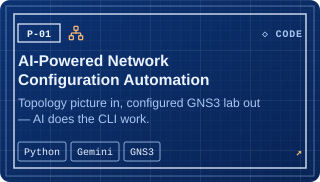</a>
<a href="https://github.com/BhonePyaeMin/Study_Ai">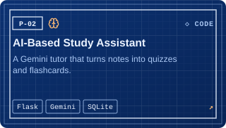</a>
<a href="https://github.com/BhonePyaeMin/netlab-3d">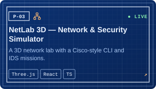</a>
<a href="https://github.com/BhonePyaeMin/asset_borrowing_system">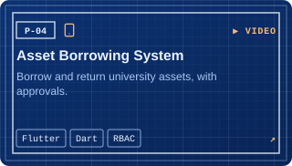</a>
<a href="https://github.com/BhonePyaeMin/network-port-scanner">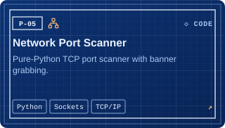</a>
<a href="https://github.com/BhonePyaeMin/GNS3-Live-Topology-Resilience-Dashboard">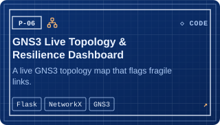</a>
<a href="https://github.com/BhonePyaeMin/Restaurant-Ordering-System">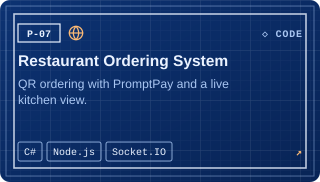</a>
<a href="https://github.com/BhonePyaeMin/Mail-Shield">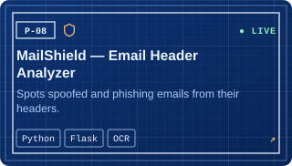</a>
<a href="https://github.com/BhonePyaeMin/Spider-Lily">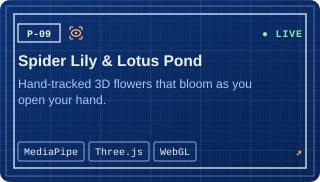</a>
<a href="https://github.com/BhonePyaeMin/Letter">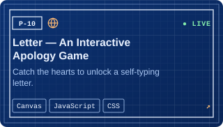</a>
<a href="https://github.com/BhonePyaeMin/secure-expense-tracker">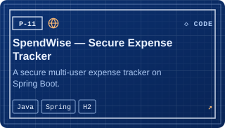</a>
<a href="https://bhonepyaemin.com/#projects">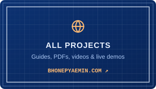</a>

<b>Running live:</b> <a href="https://bhonepyaemin.com/netlab/">NetLab 3D</a> · <a href="https://bhonepyaemin.com/mailshield/">MailShield</a> · <a href="https://bhonepyaemin.com/spiderlily/">Spider Lily</a> · <a href="https://bhonepyaemin.com/lotus/">Lotus Pond</a> · <a href="https://bhonepyaemin.com/letter/">Letter</a> &nbsp;·&nbsp; <b>Guides & PDFs:</b> <a href="https://bhonepyaemin.com/#projects">bhonepyaemin.com</a>

<picture>
  <source media="(prefers-color-scheme: dark)" srcset="https://raw.githubusercontent.com/BhonePyaeMin/BhonePyaeMin/output/github-snake-dark.svg" />
  <source media="(prefers-color-scheme: light)" srcset="https://raw.githubusercontent.com/BhonePyaeMin/BhonePyaeMin/output/github-snake.svg" />
  
</picture>

Redrawn every day from the last 12 months of commits.

Have an internship, a network to automate or a build in mind? Send it over.

📧 <a href="mailto:bhonepyaemin.tech@gmail.com">bhonepyaemin.tech@gmail.com</a> &nbsp;·&nbsp; 💬 LINE ID: <a href="https://line.me/ti/p/VS7yTGwU7A"><code>noturbusiness123</code></a>

