<table width="100%">
<tr><th align="center">Project</th><th align="left">Description</th><th align="center">Tech</th></tr>
<tr>
<td align="center"></td>
<td>Turns a topology picture into a configured, tested GNS3 network. <a href="https://github.com/BhonePyaeMin/AI-Powered-Network-Configuration-Automation">Source</a></td>
<td align="center"></td>
</tr>
<tr>
<td align="center"></td>
<td>A 3D network lab with a Cisco-style CLI and security missions. <a href="https://github.com/BhonePyaeMin/netlab-3d">Source</a> · <a href="https://bhonepyaemin.com/netlab/">▶ Live demo</a></td>
<td align="center"></td>
</tr>
<tr>
<td align="center"></td>
<td>Spots spoofed and phishing emails by analyzing their headers. <a href="https://github.com/BhonePyaeMin/Mail-Shield">Source</a> · <a href="https://bhonepyaemin.com/mailshield/">▶ Live demo</a></td>
<td align="center"></td>
</tr>
<tr>
<td align="center"></td>
<td>A live map of a GNS3 lab that flags links whose failure would split the network. <a href="https://github.com/BhonePyaeMin/GNS3-Live-Topology-Resilience-Dashboard">Source</a></td>
<td align="center"></td>
</tr>
<tr>
<td align="center"></td>
<td>A secure multi-user expense tracker built on Spring Boot. <a href="https://github.com/BhonePyaeMin/secure-expense-tracker">Source</a></td>
<td align="center"></td>
</tr>
</table>

<picture>
  <source media="(prefers-color-scheme: dark)" srcset="https://raw.githubusercontent.com/BhonePyaeMin/BhonePyaeMin/output/github-snake-dark.svg" />
  <source media="(prefers-color-scheme: light)" srcset="https://raw.githubusercontent.com/BhonePyaeMin/BhonePyaeMin/output/github-snake.svg" />
  
</picture>

Redrawn every day from the last 12 months of commits.

