 

## 🛠️ Tech stack

## 🚀 Featured projects

<table>
<tr>
<td width="50%" valign="top">

<a href="https://github.com/BhonePyaeMin/AI-Powered-Network-Configuration-Automation">Source</a>

</td>
<td width="50%" valign="top">

<a href="https://github.com/BhonePyaeMin/netlab-3d">Source</a> · <a href="https://bhonepyaemin.com/netlab/">Live demo</a>

</td>
</tr>
<tr>
<td width="50%" valign="top">

<a href="https://github.com/BhonePyaeMin/Mail-Shield">Source</a> · <a href="https://bhonepyaemin.com/mailshield/">Live demo</a>

</td>
<td width="50%" valign="top">

<a href="https://github.com/BhonePyaeMin/GNS3-Live-Topology-Resilience-Dashboard">Source</a>

</td>
</tr>
<tr>
<td width="50%" valign="top">

<a href="https://github.com/BhonePyaeMin/secure-expense-tracker">Source</a>

</td>
<td width="50%" valign="top">

<a href="https://github.com/BhonePyaeMin/Restaurant-Ordering-System">Source</a>

</td>
</tr>
<tr>
<td width="50%" valign="top">

<a href="https://github.com/BhonePyaeMin/Spider-Lily">Source</a> · <a href="https://bhonepyaemin.com/spiderlily/">Live demo</a> · <a href="https://bhonepyaemin.com/lotus/">Lotus Pond</a>

</td>
<td width="50%" valign="top">

<a href="https://github.com/BhonePyaeMin/network-port-scanner">Source</a>

</td>
</tr>
</table>

<a href="https://bhonepyaemin.com/#projects"><b>See every project, with PDFs and demos, on bhonepyaemin.com →</b></a>

## 🐍 Contribution activity

<picture>
  <source media="(prefers-color-scheme: dark)" srcset="https://raw.githubusercontent.com/BhonePyaeMin/BhonePyaeMin/output/github-snake-dark.svg" />
  <source media="(prefers-color-scheme: light)" srcset="https://raw.githubusercontent.com/BhonePyaeMin/BhonePyaeMin/output/github-snake.svg" />
  
</picture>

Thanks for stopping by — the fox up top lives on <a href="https://bhonepyaemin.com/">bhonepyaemin.com</a> too 🦊

